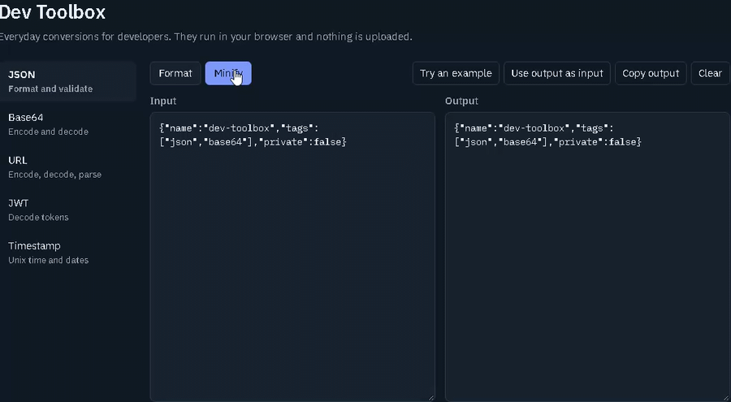

# Dev Toolbox



**[Try it live](https://sefa177.github.io/dev-toolbox/)**

Everyday developer conversions in one page. It runs entirely in your browser, so nothing you paste is uploaded anywhere.

## Tools

* **JSON**: format, minify, and validate
* **Base64**: encode (standard or URL-safe) and decode, with full UTF-8 support
* **URL**: encode, decode, and parse into protocol, host, path, and query parameters
* **JWT**: decode the header and payload and check expiry (the signature is not verified)
* **Timestamp**: convert Unix seconds or milliseconds and ISO dates to UTC, local time, and relative time

## Project structure

```
index.html        page markup
css/styles.css    styles
js/helpers.js     shared helpers (Base64, relative time)
js/tools.js       tool definitions (add new tools here)
js/app.js         UI wiring
assets/           demo image and static assets
```

## Add a tool

Each tool is one entry in the `TOOLS` array in `js/tools.js`: a name, a description, an example input, and a list of modes. A mode is a function that takes the input text and returns the output text, or throws an Error to show a message.

## License

MIT
